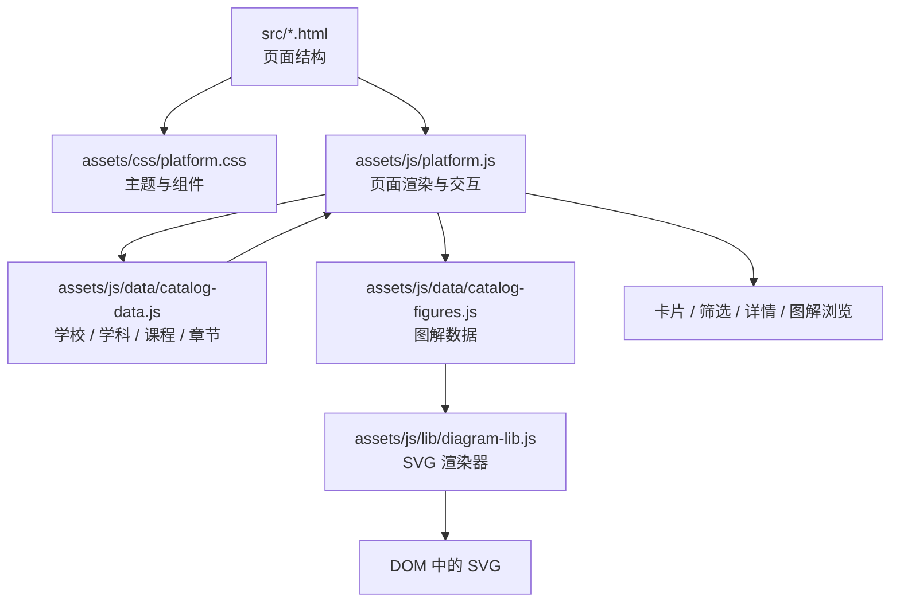

# 架构说明

## 设计目标

OpenCourseAtlas 是一个 **内容驱动、零依赖、可直接静态托管** 的图解课程库。架构围绕四个目标：

1. **内容与代码分离**：新增学校、课程、图解主要修改数据，而不是页面与渲染逻辑。
2. **零构建负担**：没有框架、打包器、转译器或运行时 npm 依赖；发布只是静态文件归集。
3. **可长期维护**：目录、数据模型、校验规则与发布流程都有明确边界。
4. **可子路径部署**：所有页面与资源使用相对路径，能部署在 `https://example.com/OpenCourseAtlas/` 这类子路径。

## 运行时分层



| 层 | 目录 | 职责 | 不应该做什么 |
| --- | --- | --- | --- |
| 页面结构 | `src/*.html` | 语义化骨架、导航、挂载点、SEO meta | 不写大段业务逻辑 |
| 样式 | `assets/css/` | 主题变量、组件、响应式、动效 | 不依赖外部 CDN |
| 交互 | `assets/js/platform.js` | 路由分发、筛选、渲染、URL 状态、图解浏览 | 不硬编码课程内容 |
| 数据 | `assets/js/data/` | 学校、学科、课程、章节、图解 | 不操作 DOM |
| 渲染 | `assets/js/lib/diagram-lib.js` | 把图解数据转为 SVG；生成课程封面 | 不发起网络请求 |
| 运维 | `scripts/` | 本地预览、构建归集、校验、发布检查 | 不引入生产依赖 |
| 自动化 | `.github/` | CI、Pages、Release、Issue/PR 模板 | 不存放业务代码 |

## 页面与路由

页面是静态 HTML，`body[data-page]` 决定初始化逻辑：

| 页面 | `data-page` | 入口参数 | 主要渲染函数 |
| --- | --- | --- | --- |
| `index.html` | `home` | — | `renderHome()` |
| `universities.html` | `universities` | 筛选状态同步到 URL | `renderUniversities()` |
| `university.html` | `university` | `?id=<school>` | `renderUniversity()` |
| `courses.html` | `courses` | `?q=&discipline=&school=&level=&sort=` | `renderCourses()` |
| `course.html` | `course` | `?id=<course>` | `renderCourse()` |
| `gallery.html` | `gallery` | `?course=<id>&fig=<index>` | `renderGallery()` |
| `mit-finance.html` | — | — | `assets/js/legacy/*` |
| `404.html` | `not-found` | — | 纯静态 |

`platform.js` 末尾的分发逻辑：

```js
const PAGE = document.body.dataset.page;
const RENDERERS = { home, universities, university, courses, course, gallery };
markNav();
navSearchBind();
RENDERERS[PAGE]?.();
bindReveal();
```

未知页面（如 `404.html`）不会执行渲染函数，只保留静态结构。

## 脚本加载顺序

平台页面必须按以下顺序加载，否则全局依赖尚未就绪：

```html
<script src="assets/js/data/catalog-data.js"></script>
<script src="assets/js/data/catalog-figures.js"></script>
<script src="assets/js/lib/diagram-lib.js"></script>
<script src="assets/js/platform.js"></script>
```

依赖关系：

```text
catalog-data.js      定义 DISCIPLINES / SCHOOLS / LEVELS / COURSES
        ↓
catalog-figures.js   定义 FIGURES（以课程 id 为键）
        ↓
diagram-lib.js       定义 DiagramLib.render / DiagramLib.cover
        ↓
platform.js          读取以上全局变量，渲染页面
```

这些都是普通 `<script>`（非 ES Module），通过全局词法作用域共享变量。新增平台脚本时，需要同步更新每个页面底部的加载顺序，或先改为模块化加载策略。

## 数据流

```text
用户进入页面
  → platform.js 读取 location.search
  → 从 COURSES / SCHOOLS / FIGURES 组合视图模型
  → 生成 HTML 字符串（esc() 转义文本）
  → 插入 DOM
  → 图解由 DiagramLib.render(figure) 生成 SVG
  → 筛选/排序变化时同步 URL，刷新视图
```

关键约束：

- **课程是聚合中心**：`COURSES` 通过 `school`、`discipline`、`chapters` 关联其他数据。
- **图解按课程聚合**：`FIGURES[courseId]` 是数组，`ch` 指向章节。
- **统计自动派生**：首页数字、学校课程数、图解体数、筛选选项都从数据计算，不手写。
- **URL 可分享**：筛选、课程、图解位置都写入 query string。

## 目录职责

```text
src/                    页面源码，构建时复制到站点根目录
assets/css/             平台与 legacy 样式
assets/img/             站点图标等静态图片
assets/js/data/         数据层（纯数据，无 DOM）
assets/js/lib/          图解渲染库
assets/js/legacy/       MIT 金融深度专题页专用脚本（隔离）
assets/js/platform.js   平台交互入口
scripts/                构建、预览、校验、发布检查
docs/                   长期文档
.github/                协作模板与自动化
```

## 图解渲染

`diagram-lib.js` 用 IIFE 暴露两个方法：

```js
DiagramLib.render(figure)   // figure.type → R[type](figure.data) → SVG string
DiagramLib.cover(course)    // 由课程 id 生成确定性几何封面
```

渲染器注册表：

```js
const R = {};
R["concept-map"] = (d) => { /* 返回 SVG 字符串 */ };
R["flow"] = (d) => { /* ... */ };
// ...
```

当前支持 14 种类型：`concept-map`、`flow`、`compare`、`layers`、`hierarchy`、`timeline`、`cycle`、`matrix`、`plot`、`tree`、`scale`、`bars`、`venn`、`cards`。未知类型回退到 `cards`。类型与数据形状见 [数据模型](data-model.md#图解类型)。

## 发布模型

```text
src/ + assets/  --(scripts/build.mjs 复制)-->  dist/
dist/           --(upload-pages-artifact)-->  GitHub Pages
```

- 构建不做压缩、哈希或转译，产物与源码结构一致，便于调试。
- `dist/.nojekyll` 关闭 GitHub Pages 的 Jekyll 处理。
- 资源没有内容哈希；更新后依赖浏览器/托管平台的缓存策略。
- 自定义域名可将 `CNAME` 放在仓库根目录，构建时自动复制。

## 扩展点

| 需求 | 改动位置 |
| --- | --- |
| 新增学校 / 课程 / 章节 | `assets/js/data/catalog-data.js` |
| 新增图解 | `assets/js/data/catalog-figures.js` |
| 新增图解类型 | `assets/js/lib/diagram-lib.js` 的 `R`，并更新数据模型文档 |
| 新增页面 | `src/<page>.html` + `platform.js` 渲染函数 + 分发表 + 导航 |
| 新增筛选维度 | `platform.js` 的 URL 状态与筛选 UI；必要时扩展数据字段 |
| 新增构建步骤 | `scripts/build.mjs`（保持零依赖，禁止引入打包器） |
| 新增自动化 | `.github/workflows/`，并在文档中说明触发条件 |

## 非目标

以下方向**不在当前架构范围内**，如需引入应先通过 Issue 讨论并更新本文档：

- 后端服务、用户账户、评论、收藏、数据库。
- 视频托管、播放器或视频转码。
- 前端框架、SSR、客户端路由库、打包器。
- CMS 或在线编辑器；内容通过 PR 审核。
- 运行时第三方依赖或外部 CDN 资源。
- 多语言站点（当前为中文）。

## 质量属性

| 属性 | 现状与策略 |
| --- | --- |
| 性能 | 约 260 KiB 静态资源；1 个 CSS、4 个平台 JS；图解为内联 SVG，无图片请求 |
| 可访问性 | 语义化 `nav/main/section`、`aria-label`、键盘图解切换；持续补足焦点样式与对比度 |
| 可维护性 | 数据/渲染/交互分层；统一数据校验；文档与代码同 PR 更新 |
| 可移植性 | 相对路径、无服务端依赖；可部署到任意静态托管 |
| 安全性 | 文本渲染使用 `esc()`；无外部脚本；安全边界见 [SECURITY.md](../SECURITY.md) |
| 可观测性 | 静态站点无后端日志；依赖 CI 校验与浏览器冒烟检查 |

## 相关文档

- [数据模型](data-model.md)
- [内容指南](content-guide.md)
- [开发指南](development.md)
- [部署指南](deployment.md)
