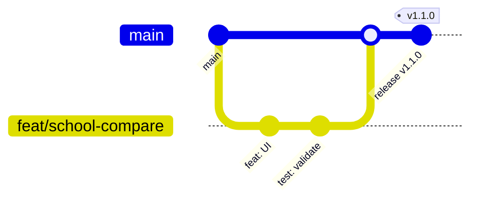

# 分支策略

## 核心原则

OpenCourseAtlas 使用 **主干开发（trunk-based development）**，不设长期 `develop` 分支：

- `main` 是唯一长期分支，始终处于可发布状态。
- 所有改动通过 **短生命周期分支 + Pull Request** 合入。
- 发布通过 **Git tag** 标记，而不是从长期发布分支切出。
- 历史保持线性、可读；合并后删除分支。

这样做的原因：项目规模小、发布频率高、内容与代码经常一起变更；长期分支会带来合并成本与版本漂移。

## 分支类型

| 分支 | 从哪来 | 合入 | 用途 | 示例 |
| --- | --- | --- | --- | --- |
| `main` | — | — | 稳定、可部署 | — |
| `feat/<slug>` | `main` | `main` | 新功能、新页面、新交互 | `feat/school-compare` |
| `fix/<slug>` | `main` | `main` | 普通缺陷修复 | `fix/gallery-keyboard` |
| `content/<slug>` | `main` | `main` | 学校 / 课程 / 图解内容 | `content/cambridge-math` |
| `docs/<slug>` | `main` | `main` | 文档、注释、README | `docs/release-process` |
| `chore/<slug>` | `main` | `main` | 工具、CI、仓库维护 | `chore/repo-standards` |
| `hotfix/<slug>` | 发布 tag | `main` | 线上紧急修复 | `hotfix/broken-assets` |
| `release/<major>.x` | `main` | — | 仅在需要维护旧大版本时创建 | `release/1.x` |

> 不建议使用 `develop`、`dev`、`test` 等长期分支；如团队未来需要，必须先更新本文档并说明发布模型。

## 命名规范

```text
<type>/<short-slug>
<type>/<issue-number>-<short-slug>
```

- 全小写，kebab-case，单词用 `-` 分隔。
- slug 描述意图，不写人名、日期或 `update`、`fix2` 等泛词。
- 可附 Issue 号，便于追踪：`feat/42-course-compare`。
- 分支名不超过 50 个字符。

示例：

```text
feat/course-compare
fix/18-gallery-overflow
content/eth-quantum-figures
docs/branch-strategy
chore/update-actions
hotfix/pages-base-path
```

## 生命周期



推荐节奏：

1. 从最新 `main` 切出分支。
2. 小步提交，每天 rebase `main`（`git fetch && git rebase origin/main`）。
3. 推送分支，开 Draft PR 尽早获得反馈。
4. CI 通过、评审通过后 squash 合并。
5. 删除本地与远端分支。

分支存活时间建议 **不超过 3 个工作日**；超过一周的 PR 应拆分或重新评估方案。

## 分支保护规则

在 **Settings → Rules → Rulesets**（或 Branches）为 `main` 配置：

| 规则 | 建议值 |
| --- | --- |
| Require a pull request before merging | ✅ |
| Required approvals | 1（单人维护时可临时设为 0，但仍走 PR） |
| Dismiss stale approvals | ✅ |
| Require review from Code Owners | ✅（`.github/CODEOWNERS`） |
| Require status checks | ✅ `CI / validate` |
| Require branches to be up to date | ✅ |
| Require conversation resolution | ✅ |
| Require linear history | ✅ |
| Block force pushes | ✅ |
| Restrict deletions | ✅ |
| Include administrators | 建议 ✅，避免例外绕过 |

Tag 保护：

- 保护 `v*`，禁止删除与强制移动。
- 只有维护者可以创建 release tag。

详细平台设置见 [仓库设置](repository-settings.md)。

## 合并策略

| 场景 | 方式 | 说明 |
| --- | --- | --- |
| 普通功能 / 修复 / 内容 PR | **Squash and merge** | 一个 PR 对应一个语义化提交 |
| 需要保留多个逻辑提交的大型重构 | **Rebase and merge** | 仅在提交已整理、每个提交可独立通过 CI 时使用 |
| 发布版本 | 通过 PR 合并版本提交 | 然后打 tag，不使用 merge commit |
| 回滚 | `git revert` + PR | 不重写 `main` 历史 |

Squash 标题必须是 Conventional Commits 格式，因为它会成为 `main` 上的最终提交信息。

合并后：

```bash
git switch main
git pull --ff-only
git branch -d <branch>
git push origin --delete <branch>
```

## 同步与变基

```bash
git fetch origin
git rebase origin/main
# 解决冲突后
git add <files>
git rebase --continue
git push --force-with-lease
```

- 只对自己的功能分支 force push，使用 `--force-with-lease`。
- 不对 `main` 或已发布的 tag force push。
- 已有人基于你的分支工作时，先沟通再 rebase。

## 热修复

当 `main` 已发布但线上出现严重问题时：

```bash
git fetch --tags
git switch -c hotfix/<slug> v1.2.0
# 修复并提交
npm run validate && npm run build
git push -u origin hotfix/<slug>
# 开 PR 到 main，评审 + CI
```

合并后：

1. 按 [发布流程](release-process.md) 发布 PATCH 版本（如 `v1.2.1`）。
2. 如果存在 `release/1.x` 维护分支，cherry-pick 修复并发布对应版本。
3. 在 Release Notes 中说明影响范围与升级建议。

## 旧版本维护

只有在以下情况才创建 `release/<major>.x`：

- 需要同时维护两个大版本，且新版本有破坏性变更。
- 旧版本仍有明确的下游使用者。

维护规则：

- 修复从 `main` cherry-pick 到维护分支，或直接在维护分支修复后再合回 `main`。
- 维护分支只接受修复与安全更新，不接受新功能。
- 在 README / Release Notes 中标注支持周期。

当前项目不维护旧版本分支；`1.x` 直接从 `main` 发布。

## 清理与例外

- 合并后自动删除远端分支（GitHub 设置中开启）。
- 每月清理超过 30 天无活动的分支；先确认没有未合并提交。
- 维护者紧急修复也应走 PR；如确需直接推送，必须在事后补 Issue 说明原因。
- 任何例外都应记录在 PR 或 Issue 中，而不是口头约定。

## 常见问题

**Q：为什么不用 Git Flow？**
A：项目发布频繁、版本少、团队规模小；`develop` 与 `release` 分支会增加同步成本，收益有限。

**Q：一个 PR 可以包含多个提交吗？**
A：可以，但合并时 squash 成一个语义化提交；如果要保留多个提交，使用 rebase merge 并确保每个提交都通过校验。

**Q：内容更新也要走分支吗？**
A：是。内容同样是代码仓库的一部分，需要评审、校验与可追溯历史。

**Q：可以直接在 GitHub 网页改 README 吗？**
A：可以，GitHub 会自动创建分支并走 PR。请确保标题符合提交规范，并等待 CI。

## 相关文档

- [提交规范](commit-convention.md)
- [版本管理](versioning.md)
- [发布流程](release-process.md)
- [仓库设置](repository-settings.md)
