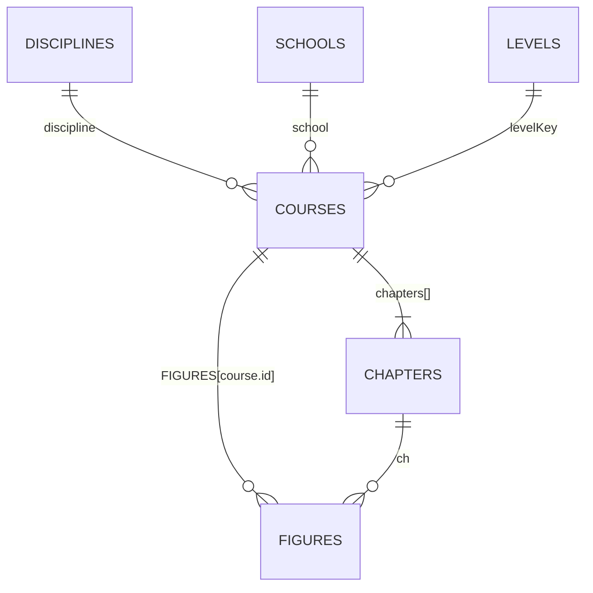

# 数据模型

平台的全部内容存放在两个普通 JavaScript 文件中，通过全局 `const` 暴露给页面：

| 文件 | 变量 | 职责 |
| --- | --- | --- |
| `assets/js/data/catalog-data.js` | `DISCIPLINES`、`SCHOOLS`、`LEVELS`、`COURSES` | 学科、学校、难度、课程与章节 |
| `assets/js/data/catalog-figures.js` | `FIGURES` | 按课程 id 聚合的知识点图解 |

这两个文件只包含数据，不操作 DOM、不发起请求。修改后运行 `npm run validate` 检查关系与类型。

## 实体关系



- 一门课程属于 **1 个学校** 和 **1 个学科**，使用 **1 个难度**。
- 一门课程至少包含 **1 个章节**，通常 3 个。
- 一张图解必须归属该课程的一个章节。
- 图解 id 只需在课程内唯一（`f01`、`f02`……）。

## DISCIPLINES（学科）

| 字段 | 类型 | 必填 | 说明 |
| --- | --- | --- | --- |
| `id` | string | ✅ | 全局唯一，kebab-case，如 `cs`、`economics` |
| `name` | string | ✅ | 中文展示名 |
| `icon` | string | ✅ | Emoji 图标 |
| `color` | string | ✅ | 十六进制主题色，用于卡片与图表 |

```js
{ id:"cs", name:"计算机科学", icon:"💻", color:"#60a5fa" }
```

## SCHOOLS（学校）

| 字段 | 类型 | 必填 | 说明 |
| --- | --- | --- | --- |
| `id` | string | ✅ | 全局唯一，如 `mit`、`eth` |
| `name` | string | ✅ | 中文校名 |
| `en` | string | ✅ | 英文校名 |
| `short` | string | ✅ | 缩写，用于卡片角标 |
| `qs` | number | ✅ | QS 排名，正整数 |
| `country` | string | ✅ | 国家/地区 |
| `city` | string | ✅ | 城市 |
| `founded` | number | ✅ | 建校年份 |
| `color` | string | ✅ | 主题色 |
| `intro` | string | ✅ | 1–3 句学校简介 |

```js
{ id:"mit", name:"麻省理工学院", en:"Massachusetts Institute of Technology",
  short:"MIT", qs:1, country:"美国", city:"剑桥市", founded:1861,
  color:"#f5c451", intro:"……" }
```

## LEVELS（难度）

| 字段 | 类型 | 必填 | 说明 |
| --- | --- | --- | --- |
| `id` | string | ✅ | `beginner` / `intermediate` / `advanced` |
| `name` | string | ✅ | 中文展示名 |
| `desc` | string | ✅ | 一句话说明 |

课程通过 `levelKey` 关联 `LEVELS.id`；`level` 是展示用中文名，两者必须语义一致。

## COURSES（课程）

| 字段 | 类型 | 必填 | 说明 |
| --- | --- | --- | --- |
| `id` | string | ✅ | 全局唯一，建议 `<学校>-<课程号>`，如 `mit-6-0001` |
| `school` | string | ✅ | 关联 `SCHOOLS.id` |
| `discipline` | string | ✅ | 关联 `DISCIPLINES.id` |
| `code` | string | ✅ | 课程号或中文简称，用于封面 |
| `title` | string | ✅ | 中文课程名 |
| `en` | string | ✅ | 英文课程名 |
| `instructor` | string | ✅ | 授课教师 / 课程来源机构 |
| `level` | string | ✅ | 展示用难度名 |
| `levelKey` | string | ✅ | 关联 `LEVELS.id` |
| `tags` | string[] | ✅ | 1–5 个关键词 |
| `source` | string | ✅ | 内容来源描述 |
| `minutes` | number | ✅ | 建议学习时长（分钟），正整数 |
| `updated` | string | ✅ | 内容更新时间，`YYYY-MM` |
| `overview` | string | ✅ | 课程概述，2–4 句 |
| `takeaways` | string[] | ✅ | 学习要点，3–5 条 |
| `prereq` | string | ✅ | 先修要求，没有则填 `"无"` |
| `chapters` | Chapter[] | ✅ | 至少 1 个章节 |
| `featured` | boolean | ❌ | 是否进入首页编辑推荐 |
| `deepLink` | string | ❌ | 关联的深度专题页，如 `mit-finance.html` |

### Chapter（章节）

| 字段 | 类型 | 必填 | 说明 |
| --- | --- | --- | --- |
| `id` | string | ✅ | 课程内唯一，`c1`、`c2`…… |
| `title` | string | ✅ | 章节标题 |
| `summary` | string | ✅ | 一句话摘要 |

```js
{
  id:"mit-6-0001", school:"mit", discipline:"cs", code:"6.0001",
  title:"计算机科学导论与 Python 编程",
  en:"Introduction to Computer Science and Programming in Python",
  instructor:"MIT OCW · Ana Bell / Eric Grimson / John Guttag",
  level:"入门", levelKey:"beginner",
  tags:["Python","编程基础","算法思维"],
  source:"MIT OpenCourseWare 公开课程整理",
  minutes:180, updated:"2026-09",
  overview:"……",
  takeaways:["……"],
  prereq:"无",
  chapters:[
    { id:"c1", title:"计算与 Python 基础", summary:"……" },
    { id:"c2", title:"控制流与函数", summary:"……" },
    { id:"c3", title:"数据结构与算法直觉", summary:"……" }
  ],
  featured:true,
  deepLink:"mit-finance.html"
}
```

## FIGURES（图解）

`FIGURES` 是一个以课程 id 为键的对象：

```js
const FIGURES = {
  "mit-6-0001": [ /* Figure[] */ ],
  "stanford-cs229": [ /* ... */ ]
};
```

### Figure（图解）

| 字段 | 类型 | 必填 | 说明 |
| --- | --- | --- | --- |
| `id` | string | ✅ | 课程内唯一，`f01`、`f02`…… |
| `ch` | string | ✅ | 关联该课程的 `chapters[].id` |
| `title` | string | ✅ | 图解标题 |
| `type` | string | ✅ | 已注册的渲染器类型，见下表 |
| `caption` | string | ✅ | 一句话说明（列表/画廊展示） |
| `explain` | string | ✅ | 详细解读，2–5 句 |
| `data` | object | ✅ | 传给渲染器的结构化数据，形状随 `type` 变化 |

## 图解类型

渲染器注册在 `assets/js/lib/diagram-lib.js` 的 `R` 对象中。未知 `type` 会回退到 `cards`。

| `type` | 用途 | `data` 形状 |
| --- | --- | --- |
| `concept-map` | 中心辐射概念图 | `{ title, center:{label,sub?}, nodes:[{label,sub?}] }` |
| `flow` | 流程图，3 列蛇形布局，可回流 | `{ title, steps:[{title,sub?}], loop? }` |
| `compare` | 双栏对比 | `{ title, left:{title,color?,items:[{k,v}]}, right:{…}, note? }` |
| `layers` | 分层架构 | `{ title, layers:[{name,desc?,tags?:string[]}] }` |
| `hierarchy` | 金字塔层级（第 0 级在底部） | `{ title, levels:[{name,desc}], note? }` |
| `timeline` | 时间轴，最多 6 个事件 | `{ title, events:[{time,title,desc?}] }` |
| `cycle` | 循环图 | `{ title, center?, steps:[{title,desc?}] }` |
| `matrix` | 2×2 矩阵 | `{ title, axes:{x,y}, quadrants:[{pos:"tl"\|"tr"\|"bl"\|"br",title,desc,color?}] }` |
| `plot` | 多序列折线图 | `{ title, xLabel, yLabel, yMin?, series:[{name,color?,values:number[]}], notes?:[{i,y,label}] }` |
| `tree` | 树形分类 | `{ title, root?:{label}, children:[{label,children?:[…]}] }` |
| `scale` | 光谱 / 标尺 | `{ title, min?, max?, markers:[{at,label,sub?,color?}], note? }` |
| `bars` | 条形图，最多 6 项 | `{ title, unit?, max?, items:[{label,value,sub?,color?}], note? }` |
| `venn` | 韦恩图，最多 3 个集合 | `{ title, sets:[{label,color?}], center?:{label}, note? }` |
| `cards` | 要点卡片，最多 6 项 | `{ title, items:[{icon?,title,desc}] }` |

渲染器会主动截断超出上限的数组（如 `slice(0,6)`），但内容应尽量控制在建议数量内，避免信息过密。

## 校验规则

`npm run validate` 会检查：

- 所有实体 `id` 唯一（图解 id 在课程内唯一）。
- 课程引用的学校、学科、难度存在。
- 章节 id 在课程内唯一，`summary` 非空。
- 每门课程至少有一组图解。
- 图解 `ch` 指向存在的章节。
- 图解 `type` 已在 `diagram-lib.js` 注册。
- 图解 `data` 为对象。
- `updated` 符合 `YYYY-MM`，`minutes` 为正数。
- `deepLink` 指向的页面存在。
- 页面引用的 CSS/JS 文件存在。

校验实现见 `scripts/validate.mjs`。新增约束时，请同步更新本文件与校验脚本。

## Schema 演进策略

| 变更 | 建议 |
| --- | --- |
| 新增可选字段 | MINOR 版本；补文档与校验，旧数据无需迁移 |
| 新增必填字段 | MINOR 版本；先提供默认值或迁移脚本，再改为必填 |
| 重命名字段 | 先保留旧字段并兼容一个 MINOR，再在 MAJOR 移除 |
| 修改 id | 视为破坏性变更；旧 id 需保留重定向或别名 |
| 删除页面 / 改变 URL | MAJOR 版本；提供重定向或 404 引导 |
| 新增图解类型 | MINOR 版本；同步 `data-model.md` 与渲染器 |

## 相关文档

- [内容指南](content-guide.md)：如何新增与审核内容
- [架构说明](architecture.md)：数据如何进入页面与 SVG
- [版本管理](versioning.md)：Schema 变更对应的版本号
